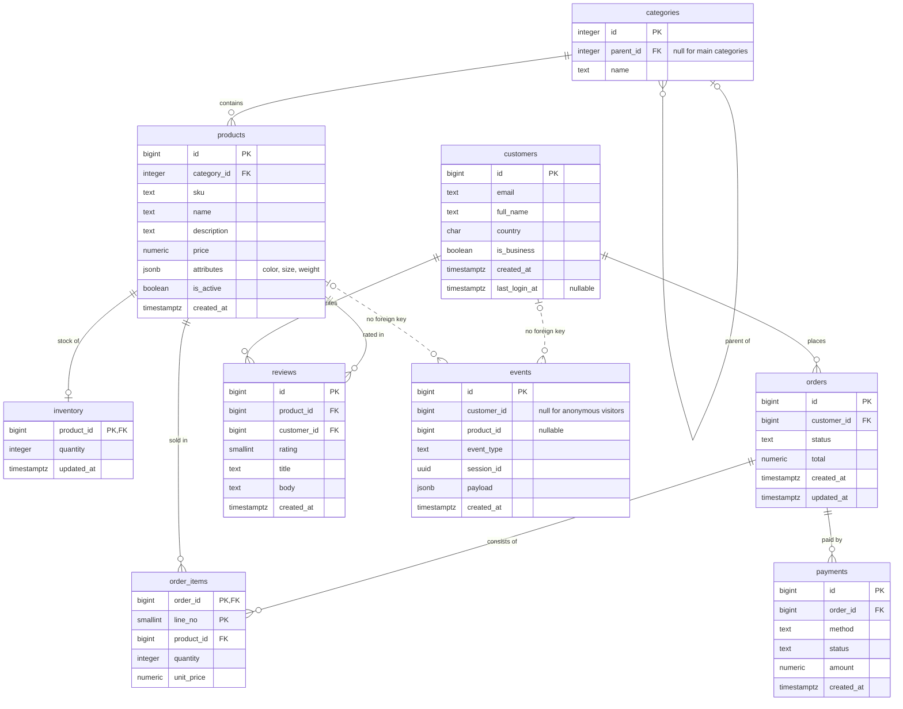

# Database schema

An online shop: customers place orders for products, pay and write reviews; the clickstream records what they do. The tables are related
enough for realistic joins, and the data is uneven enough that the same query can need a different plan for a different value.

Code: [`db/migrations`](../db/migrations), [`db/seed`](../db/seed). Instance and settings: [ADR-0005](adr/0005-database.md).

## Diagram

## Design decisions

| Decision | Reason | Alternative not chosen |
|---|---|---|
| Tables have only primary keys and foreign keys, no other indexes | Every further index is added with a measurement before and after | Indexing up front: the starting point could not be measured |
| `events` is one table without foreign keys | Inserts stay cheap, and a large time-ordered table suits the BRIN and B-tree comparison | Partitioning by month: it hides the effect of the index itself |
| `unit_price` is copied into `order_items` | A later price change must not change old orders | Reading the product's current price |
| `orders.total` is stored | Avoids summing the lines on every read | Computing it each time (a stored total can drift from its lines) |
| Status columns are `text` with a check | Allowed values are visible in the table and easy to extend | Enum types: harder to change |
| Keys are identity columns | Standard SQL; new rows are appended to the index in order | Random UUIDs: larger, and they spread writes over the whole index |
| Migrations are numbered SQL files run by [`migrate.sh`](../db/migrate.sh) | The SQL stays visible; only `psql` is needed | Flyway, Alembic: another tool for the same files |

## Views

| View | Type | Contents |
|---|---|---|
| `v_order_summary` | Plain, always current | One row per order with the customer, the number of lines and items, and the amount paid |
| `mv_daily_sales` | Materialized | Orders, units and revenue per day and category, without cancelled and returned orders |
| `mv_product_rating` | Materialized | Number of reviews and average rating per product |

A materialized view is as old as its last refresh. Both have a unique index, so `refresh materialized view concurrently` is possible:
readers are not blocked.

## Schemas and roles

| Schema | Contents |
|---|---|
| `shop` | The tables and views above |
| `ops` | `size_history`: size and use of every table and index, one set of rows per snapshot |
| `gen` | Settings and progress of the data generator |

| Role (cannot log in) | May |
|---|---|
| `app_rw` | Read and write data in `shop`; not change tables |
| `app_ro` | Read `shop` and `ops` |
| `obs_monitor` | Read server statistics (`pg_monitor`) and `ops`; no table data in `shop` |

## Generated data

The [generator](../db/seed/functions.sql) runs inside the database, so nothing is uploaded. Every value comes from a hash of the row number and a
seed, so the same seed always gives the same data, and an interrupted load continues where it stopped.

| Property | How it is uneven |
|---|---|
| Customers | 5 of 500,000 get about 10% of all orders, reviews and known visits; the others share the rest unevenly |
| Products | A tenth of the 100,000 products is sold in almost half of the order lines |
| Order status | See the table below; only the newest 5% of the orders can still be open |
| Time | 2 years (2024-11-01 to 2026-11-01), denser towards the end; rows are stored in time order |
| Missing values | 20% of the customers never logged in, 30% of the sessions are anonymous |
| Email | 10% are written with capital letters |
| Ratings | 55% five stars, few in the middle |

Order status, counted after the full load:

| Status | Orders | Share |
|---|---|---|
| delivered | 4,900,801 | 98.02% |
| cancelled | 49,695 | 0.99% |
| returned | 19,662 | 0.39% |
| shipped | 14,820 | 0.30% |
| paid | 10,016 | 0.20% |
| pending | 5,006 | 0.10% |

## Size baseline

Measured on 2026-11-25, directly after the full load, before any additional index. Row counts are PostgreSQL's own estimates.

| Table | Rows | Table | Its index | Table bytes per row |
|---|---|---|---|---|
| `events` | 15.0 million | 1465 MB | 321 MB | 102 |
| `order_items` | 15.0 million | 977 MB | 451 MB | 68 |
| `orders` | 5.0 million | 403 MB | 107 MB | 85 |
| `payments` | 5.0 million | 372 MB | 107 MB | 78 |
| `reviews` | 1.0 million | 142 MB | 21 MB | 149 |
| `customers` | 500,000 | 43 MB | 11 MB | 90 |
| `products` | 100,000 | 25 MB | 2 MB | 262 |
| `inventory` | 100,000 | 5 MB | 2 MB | 53 |
| `categories` | 200 | 56 kB | 16 kB | |
| `mv_daily_sales` | 138,701 | 10 MB | 3 MB | 72 |
| `mv_product_rating` | 99,016 | 5 MB | 2 MB | 53 |

The tables hold 41.7 million rows. The whole database is **4484 MB**, of which indexes take 23%. That is more than four times the instance's
memory (1 GB), so large queries have to read from disk. `order_items_pkey` is the largest index, although `events` has as many rows,
because it has two columns.

The load took 31 minutes in two runs and used almost all CPU credits of the instance (20 before, less than 1 after).

## Limits
- **`email` and `sku` are not unique in the database.** A unique constraint would add an index. The generator creates no duplicates, but the
  application could.
- **Foreign keys have no index on the referencing side:** deleting a customer or a product scans large tables.
- **Nothing in the database keeps `orders.total` equal to the sum of its lines;** the application has to.
- **The materialized views are not refreshed automatically,** and size snapshots are taken on demand (`ops.take_size_snapshot()`).

## Validation

| Check | Result |
|---|---|
| Migrations on an empty PostgreSQL 18.6, twice; a changed and a failing migration | A second run changes nothing; a changed file is refused; a failing file leaves nothing behind |
| Tables, roles and views ([tests](../db/tests/schema.sql)) | Pass |
| Generated data, small size ([checks](../db/seed/checks.sql)): totals, skew, time order, repeatability, continuing after a stop | Pass |
| Deliberate mistakes in the SQL ([list](../db/tests/break_it.py)) | 23 of 23 caught |
| Full load on RDS | All batches loaded, no error in the database log; order status as designed |

## Outcome and further improvements
The schema and the data are in place, and the baseline gives every later index and growth figure something to compare with.
Recommended improvements: partition `events` by month, add a unique index on `lower(email)`, and refresh the materialized views on a schedule.
